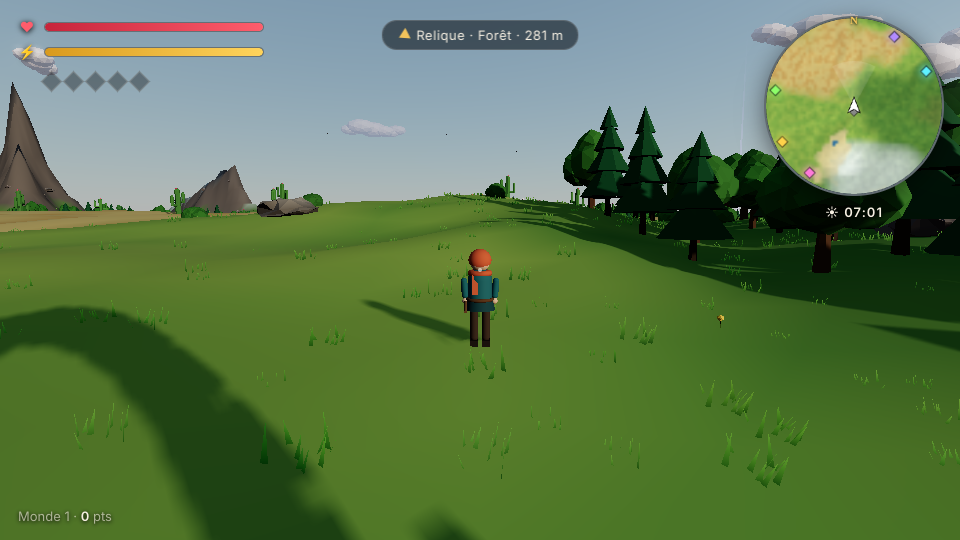
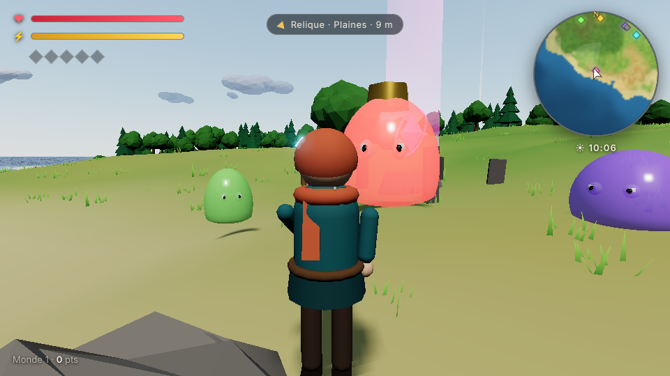
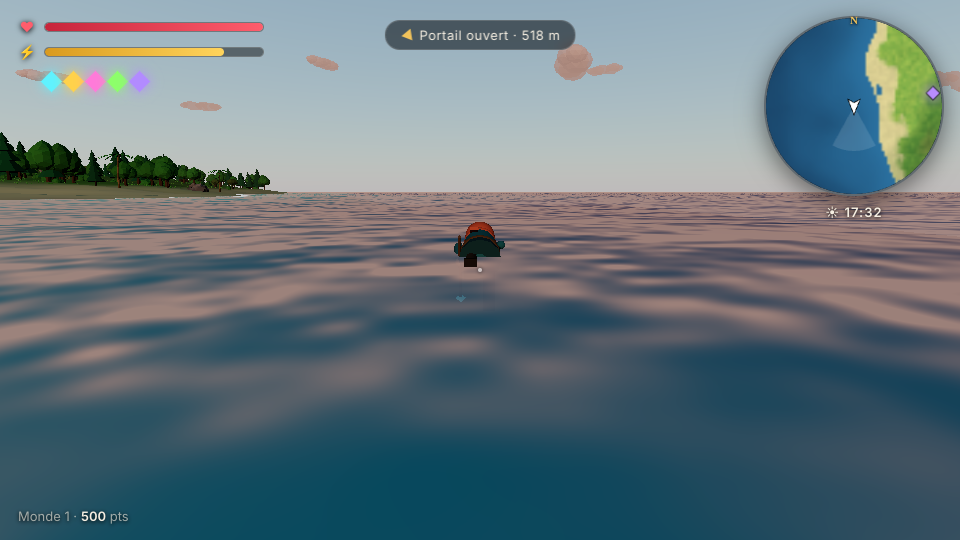
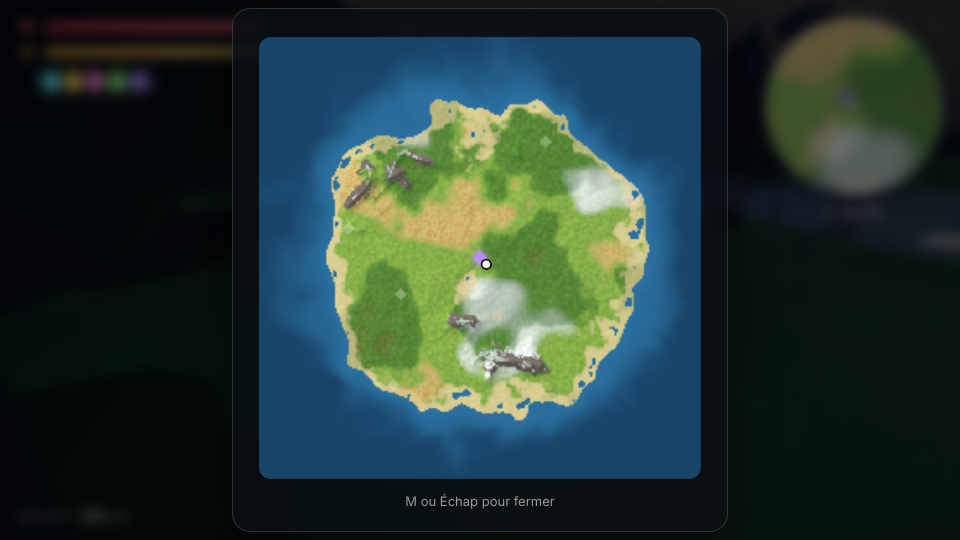

# Mondes Vivants

Jeu d'aventure 3D dans le navigateur. **100 niveaux** (une histoire par niveau), chacun sur une île née du **bruit fractal**, de plus en plus dures, avec de plus en plus de compétences.

**▶ Liste des histoires : https://loup0007a.github.io/3D-game-world/**
**▶ Une histoire : https://loup0007a.github.io/3D-game-world/1/ … /100/**

| | |
|---|---|
|  |  |
|  |  |

## Intégrer dans un autre site (iframe)

```html
<iframe src="https://loup0007a.github.io/3D-game-world/12/"
        allow="fullscreen; autoplay; gamepad"
        style="width:100%; aspect-ratio:16/9; border:0"></iframe>
```

- Cliquer dans le jeu capture la souris (Échap la libère et met en pause).
- `allow="fullscreen"` active le bouton Plein écran.
- Pas d'attribut `sandbox` (sinon il faut `allow-scripts allow-same-origin allow-pointer-lock`).
- Chaque histoire se sauvegarde à part, dans le navigateur. Certains navigateurs bloquent le stockage dans les iframes d'un autre site : le jeu marche quand même, sans sauvegarde.
- Le jeu envoie des messages à la page parente :

```js
window.addEventListener('message', (e) => {
  if (e.data?.source !== 'mondes-vivants') return;
  // e.data.type : 'start' | 'chapter' | 'complete'
  // e.data.story, e.data.chapter, e.data.ending, e.data.score, e.data.minutes
});
```

## Résultat envoyé au site principal

Comme dans le dépôt **Potions**, le jeu envoie le résultat à `https://sid-quest.vercel.app/api` (GET signé, `no-cors`, avec repli sur une image) et un `postMessage` `{ type: 'sid-quest-resultat', … }` au parent. Réglages en haut de `src/game/report.js`.

| Quand | `statut` | `raison` | `score` |
|---|---|---|---|
| Fin de l'histoire (choix fait) | `reussi` | `histoire_terminee` | 100 − 3 par mort (min. 30) |
| Bouton « Abandonner l'histoire » | `echoue` | `abandon` | 0 |
| « Recommencer » sur une partie en cours | `echoue` | `recommence` | 0 |

Champs : `email` (demandé au joueur à l'arrivée sur une histoire, gardé dans le navigateur, modifiable sur l'écran titre ; peut aussi être passé dans l'URL : `/12/?email=…`), `epreuve=mondes-vivants`, `epreuve_num=4`, `niveau` = numéro de l'histoire, `reussi`, `session`, `debut`, `fin`, `duree_s`, `details` (chapitre, morts, temps de jeu, points, fin choisie), `source`, `origine`, `parent`, `integre`, `ts`, `sig` = fnv(`sid-quest-v2|` + paramètres triés).
Les paramètres de l'URL de l'iframe (ex. `/12/?user=abc`) sont recopiés dans la requête et gardés dans les liens « Histoire suivante » et « Toutes les histoires ». Une même tentative n'est envoyée qu'une fois.

Quitter la page ne compte pas comme un échec : la partie est sauvegardée et reprend avec **Continuer**.

## Les 100 histoires

Chaque histoire a son héros, son guide, son fléau, ses ennemis, son monde et deux fins au choix. Les débuts, révélations et fins sont écrits à la main (`src/game/stories/seeds.js`). Les textes des chapitres sont assemblés à partir de modèles (`templates.js`), donc des phrases reviennent d'une histoire à l'autre. L'histoire 1 reprend les textes écrits pour le premier jeu.

Les histoires se font **dans l'ordre** : l'histoire N s'ouvre quand toutes les précédentes sont terminées (progression gardée dans le navigateur).

Structure d'une histoire :
- intro, puis **une île** : reliques, gardien, portail, épilogue (`CHAPTER_COUNT` dans `src/game/stories/index.js`) ;
- **5 reliques** par île, chacune avec un fragment d'histoire ;
- **35 artefacts cachés** par île, sans faisceau ni repère sur la carte (ils ne scintillent que de près) : chacun donne **+2 de vie max et +2 % d'attaque** jusqu'à la fin de l'histoire, dans la limite de 50 artefacts (+100 vie, attaque ×2) — réglage `ARTEFACT` dans `src/main.js` ;
- parmi eux, des **artefacts légendaires**, plus brillants : **Dieu vivant** (1 % de chance par artefact) — chaque coup terrasse l'ennemi, boss compris — et **Bouclier divin** (3 %) — 2 attaques ennemies sur 3 ratent (les chutes ne sont pas esquivées). Leur pouvoir dure jusqu'au passage du portail (fin de l'île) ;
- **raid** : mort face au gardien (jeu ouvert depuis le S.I.D.), on peut demander de l'aide aux autres membres, qui rejoignent l'île et combattent le même boss en temps réel (`src/game/raid.js`, relais par la page du S.I.D.) ;
- **niveau Donjons** (Puissance sur le S.I.D.) : à partir de 10 (10 histoires terminées), le gardien récupère ses PV quand on meurt ou qu'on s'éloigne de plus de 70 m ; à partir de 50, chaque mort a une chance sur 2 de coûter un membre (simulation fermée un moment) — réglage `DONJON` dans `src/main.js` ;
- **dragon** : à partir de 90 de Puissance sur le S.I.D., le gardien est un dragon volant qui plonge et crache du feu ;
- Échos renforcés (PV ×1,3, dégâts ×1,2, vitesse ×1,2) et tous capables d'attaquer à distance ; dans les premières histoires leurs tirs sont plus rares, plus faibles et mieux annoncés (réglages `BUFF` et `SHOT` dans `src/entities/slimes.js`) ;
- quand toutes les reliques sont prises, un **gardien** (boss) apparaît au portail : il bondit (cercle rouge), invoque des renforts, puis crache des salves à mi-vie ;
- au chapitre 10, le gardien final, puis le choix de fin et l'écran « Histoire suivante ».

Durée estimée : **14 à 16 minutes** par niveau (calcul à partir du nombre de reliques et des combats, pas mesuré en jouant).

### Difficulté

| | Histoire 1 | Histoire 50 | Histoire 100 |
|---|---|---|---|
| Vie des ennemis | ×1 | ×2,1 | ×3,2 → ×4 |
| Dégâts des ennemis | ×1 | ×1,7 | ×2,4 → ×2,65 |
| Nombre d'ennemis | ×1 | ×1,6 | ×2,2 → ×2,55 |
| Régénération | 2,5/s | 1,75/s | 1/s |

Nouveaux ennemis au fil des niveaux : feu follet (4), **Rôdeur** qui charge en ligne droite après un cercle d'avertissement (9), cracheur (14), **Grondeur** qui fonce et explose (21), golem (28), **essaims de Moucherons** (36), ombre (44), **Mage des Échos** qui tire et appelle des renforts (55), **Mimiques** déguisées en artefacts (63). Des **Échos d'élite** (halo doré, ×2,5 PV) apparaissent de plus en plus souvent et lâchent toujours du butin.

**Butin** (`src/entities/loot.js`) : orbes de soin, ⚔️ Éclat de force (+50 % de dégâts 20 s), 🪶 Plume de vent (+35 % de vitesse 15 s), 🛡️ Fiole de garde (absorbe 2 coups), 📜 Parchemin d'éveil (recharge les compétences), ❤️ Cœur ancien (+5 vie max pour le niveau), 💎 Gemme (+150 points). Les élites et les Mimiques donnent du butin rare ; le gardien laisse un trésor. Les effets en cours s'affichent en haut à gauche.

**La Chronique des Mondes Vivants** (`src/game/stories/saga.js`) relie les 100 niveaux : cent mondes rêvés dans l'Archive, que la Fêlure et l'Oublieur éteignent un à un. 10 Âges de 10 niveaux ; le 10e monde de chaque Âge est gardé par un Écho de l'Oublieur (Morne, la Sourdine, Sève-Noire, le Noyeur, l'Oiseau de Cendre, le Rouage Fou, le Double, Nuit-sans-Lune, Ignivore le Dernier Dragon, puis l'Oublieur au niveau 100). Dans chaque niveau, les 5 reliques racontent l'histoire du monde jusqu'à sa vérité (4e relique).

### Compétences par histoire

| | Compétences en tout | Au départ | À retrouver |
|---|---|---|---|
| Histoire 1 | 5 | 0 | 5 |
| Histoire 50 | 10 | 4 | 6 |
| Histoire 100 | 16 | 8 | 8 |

Une compétence revient avec la première relique de chaque chapitre. Ensuite, une relique sur deux donne une force (vie, endurance, recharges, dégâts). Les histoires avancées donnent aussi des forces dès le départ.

## Jouer

```bash
npm install
npm run dev        # serveur local
npm run build      # dist/ + dist/1 … dist/100 (GitHub Pages)
npm run build:single  # un seul fichier HTML jouable hors ligne, dans dist-single/
```

En local (`npm run dev`) ou avec le fichier unique, une histoire s'ouvre avec `?story=12`.

## Contrôles

| Action | Clavier / souris |
|---|---|
| Se déplacer (relatif à la caméra) | ZQSD (AZERTY) ou WASD |
| Caméra | Souris (clic pour capturer) · clic droit glissé en repli |
| Zoom | Molette |
| Sauter / remonter en nageant | Espace |
| Courir / nager vite | Shift |
| Frapper | Clic gauche ou F |
| Ruée | E |
| Éclat (projectile) | Clic droit ou R |
| Onde de choc | C |
| Bouclier · Souffle · Foudre · Ralenti · Racines | 1 · 2 · 3 · 4 · 5 |
| Double / triple saut | Espace en l'air |
| Planeur | Maintenir Espace en chute |
| Frappe céleste | Frapper en l'air |
| Pas sur l'eau | Courir sur l'eau |
| Carte | M |
| Journal | J |
| Pause | Échap |

Sur mobile : joystick à gauche, glisser à droite pour la caméra, boutons d'action.

## Les 16 compétences

| | Compétence | Touche | Effet |
|---|---|---|---|
| ➶ | Ruée | E | Bond rapide, invulnérable, possible en l'air |
| ⇈ | Double saut | Espace ×2 | Second saut avec salto |
| ✦ | Éclat | Clic droit / R | Projectile, visée assistée vers l'ennemi le plus proche du viseur |
| 🜁 | Planeur | Espace maintenu | Ailes de lumière, plus de dégâts de chute |
| ◎ | Onde | C | Repousse et blesse tous les ennemis autour |
| ⛉ | Bouclier | 1 | Absorbe tous les coups pendant 4 s |
| ⤓ | Frappe céleste | Frapper en l'air | Plongeon et onde au sol |
| ✚ | Souffle | 2 | Rend 40 % de la vie en 2 s |
| ◈ | Compagnon | auto | Un esprit tire sur les ennemis proches |
| ϟ | Foudre | 3 | Éclair qui saute sur 5 ennemis |
| ⇮ | Triple saut | Espace ×3 | Troisième saut en l'air |
| ⧗ | Ralenti | 4 | Ennemis ralentis 5 s |
| ≈ | Pas sur l'eau | Courir | La surface de l'eau porte en courant |
| ❦ | Racines | 5 | Immobilise les ennemis autour 3 s |
| ⊛ | Aimant | auto | Les orbes de soin viennent à toi |
| ∞ | Second souffle | auto | Courir fatigue moins, l'endurance revient plus vite |

## Comment le monde est généré

1. **Relief** : Simplex 2D seedé, fBm + distorsion de domaine pour des côtes organiques, masque radial pour former une île, bruit « ridged » pour les crêtes de montagne.
2. **Climat** : deux autres cartes de bruit (température, humidité). La température baisse avec l'altitude et vers le nord.
3. **Biomes** : poids doux (plage, plaines, forêt, désert, toundra, marais) mélangés par sommet, puis roche sur les pentes et neige sur les sommets. Les zones se fondent au lieu de se couper net.
4. **Végétation** : grille jitterée, densité modulée par un bruit de « bosquets ». Chênes, sapins, sapins enneigés, palmiers, cactus, saules, buissons, rochers, herbe et fleurs, tous en `InstancedMesh` avec du vent dans le vertex shader.
5. **Vie** : bancs de poissons (boids) qui évitent les côtes et fuient le joueur, volées d'oiseaux.

## Déplacement

La course est pilotée pour rester fluide : passage progressif marche → course, le vecteur vitesse **tourne** au lieu de sauter d'une direction à l'autre, freinage court, demi-tour avec dérapage, ralentissement en montée. Saut avec tampon et « coyote time ».

L'animation est procédurale : la foulée suit la distance parcourue (les pieds ne glissent pas), genoux et coudes pliés, rebond différent en marche et en course, torsion bassin/épaules, inclinaison dans les virages et à l'accélération, réception amortie, foulard qui flotte. La caméra élargit le champ de vision en course, en ruée et en planeur.

## Rendu

Three.js r169 · ciel atmosphérique (`Sky`) · ombres douces qui suivent le joueur · eau en shader (vagues, reflets de Fresnel, écume sur les côtes via une texture de profondeur) · bloom · brouillard accordé à l'heure · étoiles, lune, nuages · vue sous-marine. Qualité basse / moyenne / haute dans la pause.

## Structure

```
src/
  main.js              boucle, états, routes, sauvegarde, gardiens, événements
  game/stories/        100 graines, modèles de texte, générateur, difficulté
  game/story.js        textes écrits à la main de l'histoire 1
  game/skills.js       16 compétences
  core/                noise, input, caméra 3e personne, audio synthétisé
  world/               terrain + biomes, eau, ciel, végétation
  entities/            joueur, ennemis + gardiens, reliques + portail, faune, particules
  ui/hud.js            barres, minimap, carte, messages
  ui/story-ui.js       dialogues de Lueur, cartes de mémoire, journal, barre de compétences
```

`scripts/routes.mjs` crée une page par histoire après le build.

Aucun asset externe : modèles en géométrie procédurale, sons en WebAudio.

## Licence

MIT

**Puissance et histoires.** Chaque histoire terminée depuis le S.I.D. rapporte +1 Puissance ; avec N de Puissance, les histoires 1 à N+1 sont ouvertes.
